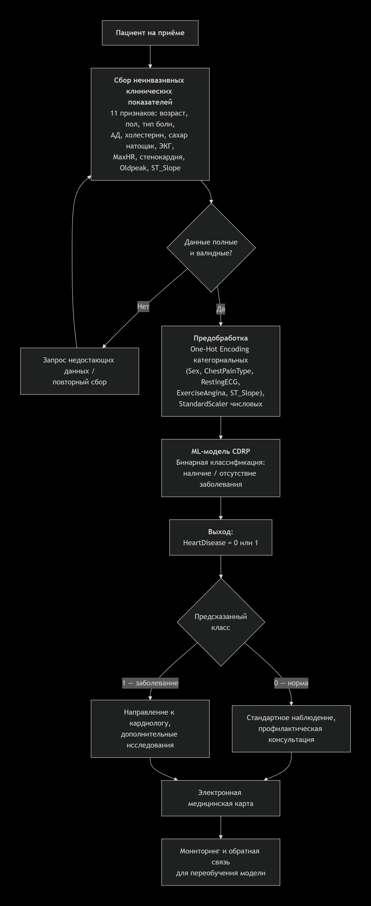

## Краткое описание
### Какую задачу в процессе решает модель
Модель выполняет роль бинарного классификатора на этапе первичного скрининга: по 11 неинвазивным клиническим показателям она предсказывает наличие или отсутствие сердечного заболевания (HeartDisease = 1 или 0). Это позволяет врачу быстро выделить пациентов, которым требуется углублённое обследование.
### Почему для этой задачи целесообразно использовать ML
ML-модель выявляет взаимодействия между признаками, которые сложно учесть в фиксированных клинических шкалах. Модель обеспечивает воспроизводимость и может быть переобучена при появлении новых данных.
### Какие данные поступают на вход модели
|Признак| Тип| Описание|
|-----|-----|----|
|Age| Числовой | Возраст пациента (годы) |
|Sex| Категориальный | Пол пациента (M: мужской, F: женский) |
|ChestPainType| Категориальный | тип боли в груди (TA: типичная стенокардия, ATA: атипичная стенокардия, NAP: не стенокардическая боль, ASY: бессимптомно) |
|RestingBP| Числовой | артериальное давление в покое (мм рт. ст.) |
|Cholesterol| Числовой | холестерин общий (мг/дл) |
|FastingBS| Числовой | уровень сахара в крови натощак [1: если FastingBS > 120 мг/дл, 0: иначе] |
|RestingECG| Категориальный | ЭКГ в покое (Normal, ST: Инверсии зубца Т и/или подъем или депрессия сегмента ST более 0,05 мВ, LVH: показывает вероятную или явную гипертрофию левого желудочка по критериям Эстеса) |
|MaxHR| Числовой | максимальная частота сердечных сокращений (числовое значение от 60 до 202) |
|ExerciseAngina| Категориальный | стенокардия, вызванная физической нагрузкой [Y: Да, N: Нет] |
|Oldpeak| Числовой | Депрессия ST |
|ST_Slope| Категориальный | Наклон ST при нагрузке (Up, Flat, Down) |
### Как результат работы модели используется дальше в процессе
Выход модели — бинарная метка HeartDisease — интегрируется в электронную медицинскую карту как вспомогательная информация для врача. При классе 1 пациент направляется к кардиологу и на дополнительные исследования; при классе 0 — стандартное профилактическое наблюдение. Накопленные данные о фактических исходах используются для мониторинга и переобучения модели.
